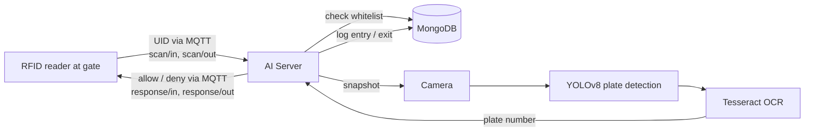

# Smart City IoT Monitoring System

An IoT-based smart city monitoring system for collecting, processing, and visualizing real-time environmental data using ESP32 and a ThingsBoard-based Core IoT platform, combined with an AI server for license plate recognition and RFID-based parking access control.

[](https://www.youtube.com/watch?v=kwJrfP_ZU7A)

🎥 **[Watch the full demo on YouTube](https://www.youtube.com/watch?v=kwJrfP_ZU7A)**

## Overview

The system integrates multiple sensors with an ESP32 device to monitor environmental conditions and transmit real-time telemetry through MQTT. The data is visualized on an IoT dashboard, with configurable thresholds, alarms, and scheduled device control.

For the smart parking module, a Python AI server works alongside the IoT devices: when a vehicle scans an RFID card at the gate, the server checks the card against a whitelist, captures a camera snapshot, detects the license plate with YOLOv8, reads it with OCR, and records the vehicle's entry and exit in MongoDB.

## Features

* 🌡️ Real-time temperature and humidity monitoring
* 🌫️ Air quality and motion monitoring
* 📡 MQTT communication over Wi-Fi
* 🔄 Automatic Wi-Fi reconnection
* ⚠️ Threshold-based environmental alarms
* ⏰ Scheduled parking light control

  * ON at 18:00
  * OFF at 06:00
* 🔄 OTA firmware update
* 📊 Real-time IoT dashboard and data visualization
* ⚙️ Device configuration using NVS
* 🚗 License plate detection (YOLOv8) and recognition (Tesseract OCR)
* 🪪 RFID access control with a MongoDB whitelist
* 🅿️ Vehicle entry/exit tracking with plate matching on exit
* 🌐 REST API and live camera stream for dashboard integration

## Technologies

* **Embedded:** ESP32, FreeRTOS
* **Communication:** Wi-Fi, MQTT
* **IoT Platform:** ThingsBoard-based Core IoT Platform
* **Sensors:** DHT11, MQ135, PIR
* **Firmware:** NVS, OTA
* **Dashboard:** Core IoT / ThingsBoard-style Dashboard
* **AI / Computer Vision:** YOLOv8 (Ultralytics), OpenCV, Tesseract OCR
* **Backend:** Python, Flask, paho-mqtt
* **Database:** MongoDB

## Repository Structure

```
├── src/, include/, lib/, boards/   # ESP32 firmware (PlatformIO)
├── platformio.ini
├── ai_server/                      # AI server: license plate recognition + RFID access control
└── img/                            # Dashboard screenshots
```

## AI Server: License Plate Recognition & Parking Access Control

### How It Works



1. **Entry:** the reader publishes the card UID to `yolouno/rfid/scan/in`. The server checks the UID against the whitelist, captures a snapshot, extracts the plate number, and stores an entry record.
2. **Exit:** on `yolouno/rfid/scan/out`, the server extracts the plate again and compares it with the plate recorded at entry. Small OCR differences are tolerated; real mismatches are saved as reports for review.
3. **Response:** the result (allowed/denied, plate number, match status) is published back to the device on the matching response topic.

### Structure

```
ai_server/
├── startup.py            # Interactive launcher: dependency checks, start modes, config view
├── camera/
│   ├── camera.py         # VideoCamera, YOLOv8 detection, OCR preprocessing
│   └── video_camera.py   # Flask server: video stream, snapshot and vehicle APIs (runs RFID server)
├── rfid/
│   ├── rfid_mqtt_server.py     # RFID MQTT server (access check only)
│   └── rfid_mqtt_server_v2.py  # RFID MQTT server with vehicle entry/exit
├── database/
│   └── whitelist_db.py   # MongoDB: whitelist, access logs, plates, vehicle tracking
└── config/
    ├── settings.py       # MQTT broker/topics, MongoDB, Flask settings
    └── paths.py          # Data, log and model paths
```

### Getting Started

**Requirements:** Python 3.9+, MongoDB running on `localhost:27017`, [Tesseract OCR](https://github.com/tesseract-ocr/tesseract) (default path `C:/Program Files/Tesseract-OCR/tesseract.exe`, set in `camera/camera.py`), and a webcam.

```bash
cd ai_server
pip install -r requirements.txt
python startup.py
```

The launcher offers several modes: the integrated system (camera + RFID), RFID server only, camera only, and RFID v2 with entry/exit. Each service can also be run directly:

```bash
python -m camera.video_camera        # Flask server on port 5000 + RFID v2
python -m rfid.rfid_mqtt_server_v2   # RFID MQTT server only
```

The MQTT broker, topics and database are configured in `ai_server/config/settings.py`.

### Main API Endpoints

| Method | Endpoint | Description |
|---|---|---|
| GET | `/video_feed` | Live MJPEG camera stream |
| GET | `/snapshot?flag=1&crop=1&extract_plate=1` | Capture a frame and optionally extract the plate number |
| GET | `/rfid/status` | RFID server status |
| GET | `/rfid/whitelist` | List authorized cards |
| POST | `/rfid/add_card`, `/rfid/remove_card` | Manage the whitelist |
| GET | `/vehicle/parking_status` | Vehicles currently in the parking lot |
| GET | `/vehicle/history/<uid>` | Entry/exit history of a card |
| GET | `/vehicle/recent_plates` | Recently recognized plates |
| POST | `/vehicle/force_exit` | Manually check out a vehicle |

### MQTT Topics

| Topic | Direction | Purpose |
|---|---|---|
| `yolouno/rfid/scan/in` | Device → Server | Card scanned at the entry gate |
| `yolouno/rfid/scan/out` | Device → Server | Card scanned at the exit gate |
| `yolouno/rfid/response/in` | Server → Device | Entry decision |
| `yolouno/rfid/response/out` | Server → Device | Exit decision |

## Dashboard

### Main Dashboard


### Environmental Monitoring


### Sensor Details & Alarms


### Parking Dashboard


